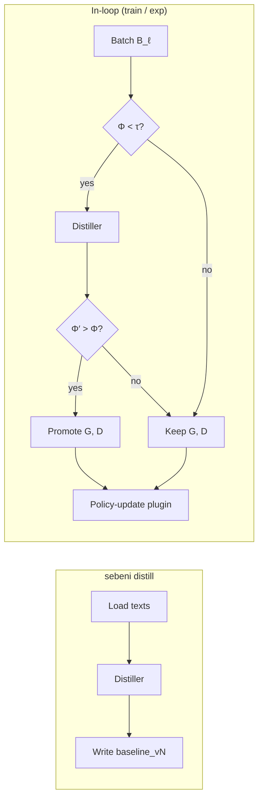

# Distillation and DabaX

Distiller in SAMPG proposes candidate grammar and dictionary files when Φ on a
batch of **texts** falls below τ. Sebeni promotes them only if Φ′ > Φ (and
SafetyGovernor agrees). There is no separate `refgen` package.



`sebeni distill` writes G, D **without** a policy step. `sebeni train` /
`sebeni exp` run the same Distiller path automatically (per language in the
batch) via `SelfAwareCallback`. `distillation_hook` is KL scaling, not Distiller.

## What Distiller writes

Daba-compatible **G** (`.gram` finite-state / Select-Mark rules) and **D**
(`.dict` SIL Toolbox / MDF fields). Every proposal starts from a DabaX stage −1
**miss list**: the unique surfaces in the batch that the current G, D cannot
analyse. Grammar patterns use the Daba form (see
`beni/data/samples/grammar.guide`):

```
pattern select_gloss | mark_gloss
```

What a miss turns into depends on the backend:

- `algorithmic` appends one conservative lookup entry per unseen surface to
  **D** (`\lx <surface>`, `\ps x`, `\ge auto:<surface>`). **G** is left unchanged.
- LLM backends may also propose **G** changes (e.g. a missing splitter or
  constraint such as `{|na}`). On a scratch stub they return full files; once a
  real baseline exists they return action-tagged deltas (`[ADD]`,
  `[REPLACE: \lx lemma]` / `[REPLACE: @macro]`, `[DELETE: …]`) that Distiller
  applies to the current files. An empty dictionary delta falls back to the
  algorithmic `\lx` entries.

Promoted files are versioned `baseline_vN.gram` / `baseline_vN.dict` under
`{working_dir}/data/baselines/{lang}/`.

## CLI

```bash
sebeni distill -c config.yaml
sebeni distill -c config.yaml --lang bam --lang mku --hitl
sebeni distill -c config.yaml -w ./runs/other-workdir
```

The default `algorithmic` backend needs no API key. Use `distill` when you want
G, D without a policy step. Texts are grouped by language and each group gets
its own Distiller.

## Backends and authentication

```yaml
distillation:
  enabled: true
  backend: algorithmic      # algorithmic | gguf | google | gemini | openai | groq | together
  model: gemini-2.5-flash   # LLM backends only; use the provider's model id
  tau: 0.5
  hitl: false
  vertex: false             # google/gemini: use ADC / Vertex AI
  base_url: null            # openai/groq/together: OpenAI-compatible endpoint
  gguf_path: null           # gguf: path to the .gguf model file
  n_ctx: 4096               # gguf context window
  max_input_chars: 8000     # cap on current G / D text sent to an LLM
```

`provider:` is still accepted as a deprecated alias for `backend:`.

- `algorithmic` builds a DabaX stage −1 miss list and adds conservative `\lx`
  entries. This is the train/exp default.
- `google` / `gemini` needs `sebeni[distil]` (`google-genai`). It accepts
  `GOOGLE_API_KEY` (or `GOOGLE_API`), or ADC/Vertex with `vertex: true` and
  `GOOGLE_CLOUD_PROJECT` (or `GOOGLE_PROJECT_ID`); region comes from
  `GOOGLE_CLOUD_LOCATION` / `GOOGLE_LOCATION` (default `us-central1`). With no
  API key, Vertex is switched on automatically when
  `GOOGLE_APPLICATION_CREDENTIALS`, `GOOGLE_CLOUD_PROJECT` or
  `GOOGLE_PROJECT_ID` is set.
- `openai`, `groq` and `together` call the Chat Completions HTTP API directly
  (JSON mode) and read `OPENAI_API_KEY`, `GROQ_API_KEY` or `TOGETHER_API_KEY`.
  The endpoint can be changed with `base_url` (or `OPENAI_BASE_URL`,
  `GROQ_BASE_URL`, `TOGETHER_BASE_URL`), e.g. for Ollama/vLLM; with `base_url`
  set, a missing key is replaced by a dummy one. Set `model` explicitly: the
  config default is a Gemini id.
- `gguf` runs a local model through `llama-cpp-python` and requires
  `sebeni[gguf]` and `gguf_path`. It emits a `RuntimeWarning`: its limited
  context (`n_ctx`) and lack of hosted caching/optimization can reduce quality
  and throughput.
- `.env` is loaded from the current directory, the config directory, the
  workdir, or `SEBENI_ENV`; existing process variables win.

LLM prompts contain the miss report, the language metadata, the format samples
in `beni/data/samples/` (`*.gram`, `*.dict`, `*.guide`) and, in delta mode, the
current G and D truncated to `max_input_chars` — never the full production
dictionary.

## Scratch bootstrap

No packaged `beni/data/baselines/{lang}/` → Distiller writes lookup-only stubs
(marked `sebeni-scratch-bootstrap`) under the workdir. Algorithmic bootstrap
adds missing surfaces as lemmas. When a packaged baseline exists it is copied
into the workdir as `baseline.gram` / `baseline.dict` first.

| Promote | Gate |
| --- | --- |
| First create (no `baseline_vN` in the workdir yet) | files must be **parseable** by DabaX |
| Later `baseline_vN` | Φ′ > Φ on **that language's** batch texts |

With `safety.enabled: false` SafetyGovernor promotes every proposal.

`--hitl` prints the first 800 characters of the proposed grammar and dictionary
and asks `Promote this baseline? [y/N]` before the SafetyGovernor check. When
stdin is not a TTY (CI) the prompt is skipped and the proposal goes straight to
the governor.

## DabaX

Wraps CLI `daba.mparser` (`DictLoader`, `GrammarLoader`, `Tokenizer`,
`Processor`). No wxPython / `gparser` / `gdisamb` on the default install.
Upstream credit: [maslinych/daba](https://github.com/maslinych/daba) (GPLv2+).
Install it with
`pip install "daba @ git+https://github.com/maslinych/daba.git" --no-deps`.
Sebeni pins `setuptools<81` (`pkg_resources`) and the other CLI runtime
libraries (`funcparserlib`, `intervaltree`, `pytrie`, `attrdict3`, `regex`).
The unrelated PyPI package `daba` is detected and rejected with an install
hint. Do not vendor GPL sources into this MIT tree.

`get_dabax(lang, gram=None, ldict=None)` returns a cached `DabaX` for a
language's current G, D (rebuilt only when the paths change);
`clear_dabax_cache(lang)` drops it after a promote. Without explicit paths,
files resolve to the latest paired workdir `baseline_vN`, then workdir
`baseline.*`, then the packaged baseline.

```python
from beni.core.morphotactic.distil.distillation import Distiller
from beni.core.morphotactic.dabax import DabaX, get_dabax

d = Distiller(lang_code="bam", backend="algorithmic", working_dir="./runs/bam")
d.handle_baselines()
phi = d.phi_on_texts(["Aw ka kɛnɛ wa?"])
proposal = d.propose(["Aw ka kɛnɛ wa?"])   # DistillProposal or None (no misses)

dx = DabaX("bam", gram=d.gram_path, ldict=d.dict_path, process=True)
sentences = dx.loader("Aw ka kɛnɛ wa?")
dx = get_dabax("bam", gram=d.gram_path, ldict=d.dict_path)  # cached
```

Φ here is morphological integrity of the **strings**, given G and D — the
same quantity SAMPG compares to τ. Constructed directly, `Distiller` defaults
to `model="gemma-4-26b-a4b-it"`; the CLI passes `distillation.model`.
