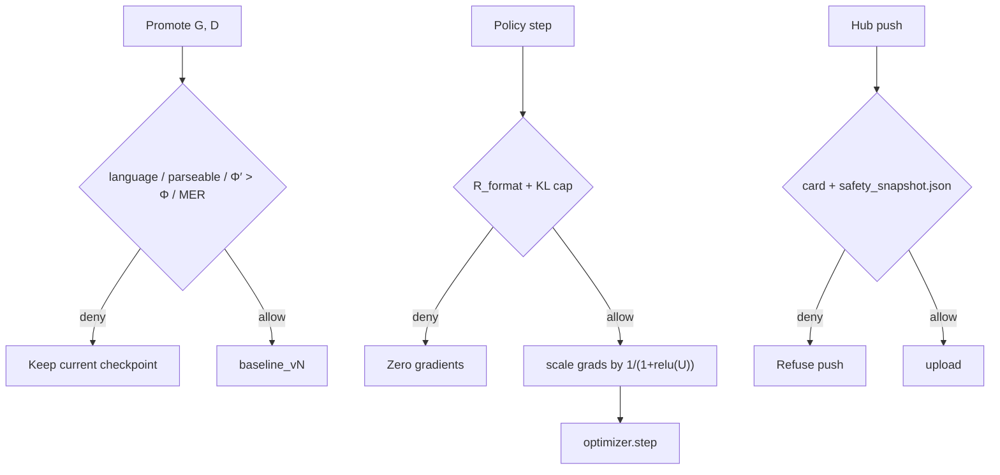

# Safety

`SafetyGovernor` is consulted on every SAMPG promote, policy update, and
Hub export. It encodes ELRL linguistic integrity **and** reward distrust
(noisy `π_rf` must not update θ unchecked).



## SafetySpec (default-on)

| Gate | Default | Effect |
| --- | --- | --- |
| Language identity | on | ISO/group required; `R_lang` vs **that row** scores 0 for a JSON `lang` that does not match the row's group; a proposal with `language_ok=False` is not promoted. Mixed-language **datasets** are allowed. |
| Morphological integrity | on | τ and Φ′ > Φ on the batch texts using that language's grammar G and dictionary D; deny if a proposal's MER exceeds `max_mer` (1.0) |
| Reward distrust | on | Batches whose format scores average 0 cannot update; uncertainty U down-weights gradients; optional KL cap `max_kl` |
| Checkpoint integrity | on | Distiller writes `baseline_vN` only if gates pass |
| Release integrity | on | no Hub push without a model card (`README.md`) and `safety_snapshot.json` (Φ, τ, checkpoint id) |

Scratch first-create uses the parseable-file gate; every later checkpoint
must also be parseable and satisfy Φ′ > Φ.

Every gate that fires appends its name to `SafetySpec.fired` (e.g.
`phi_not_improved`, `unparseable_bootstrap`, `mer_exceeded`,
`format_invalid_batch`, `kl_bound`, `uncertainty_downweight`,
`missing_model_card`); the list is copied into the snapshot's `gates_fired`.
With `enabled: false` every gate allows.

Maninka: metadata `group_code` is **mku**; packaged files live under
`baselines/mku/`, and the code `mlq` resolves to the same group.

## YAML

```yaml
safety:
  enabled: true
  require_language: true
  refuse_mixed_language: true
  require_phi_improve: true
  max_mer: 1.0
  format_invalid_blocks_update: true
  uncertainty_downweight: true
  require_model_card: true
  require_safety_snapshot: true
  # max_kl: 0.5   # optional hard KL cap
```

τ is taken from `distillation.tau` (default 0.5). KL β (`SafetySpec.kl_beta`)
is `trainer.beta` (default 0.1); the JAX DPO/APO step uses the active
`dpo.beta` / `apo.beta` for U.

U is computed per policy batch as
\(I(stage_{pred}\ne-1)+\beta\log((\pi_\theta+\epsilon)/
(\pi_{ref}+\epsilon))\). Morphological and LM tokens are averaged separately.
If the policy or reference log-probs are missing, U is skipped (scale 1).
The update scale is \(1/(1+\operatorname{relu}(U))\), so negative U never
amplifies a step. `u_indicator`, `u_kl`, and `uncertainty` are logged to
Trackio each step and recorded as release indicators in
`safety_snapshot.json`; they never gate G/D promotion.

When a batch is denied the governor zeroes the gradients before
`optimizer.step` (the step itself still runs on zero gradients).

## Python

```python
from beni.core.safety import SafetyGovernor, SafetySpec

gov = SafetyGovernor(SafetySpec(tau=0.5))
d = gov.allow_promote(phi=0.4, phi_prime=0.6, parseable=True, first_create=False)
assert d.allowed

assert gov.allow_policy_update({"format_scores": [0.0, 0.0]}) is False
```

Training builds the spec with
`MasterConfig.safety.to_spec(tau=distillation.tau, kl_beta=trainer.beta)`.
Saving a model writes the model card and `safety_snapshot.json` together.
`sebeni eval` writes `safety_snapshot.json` into the working directory's
`models/` folder. `sebeni push` writes the card and snapshot if they are
missing, then refuses the upload (`PermissionError`) unless
`allow_hub_push` passes.
