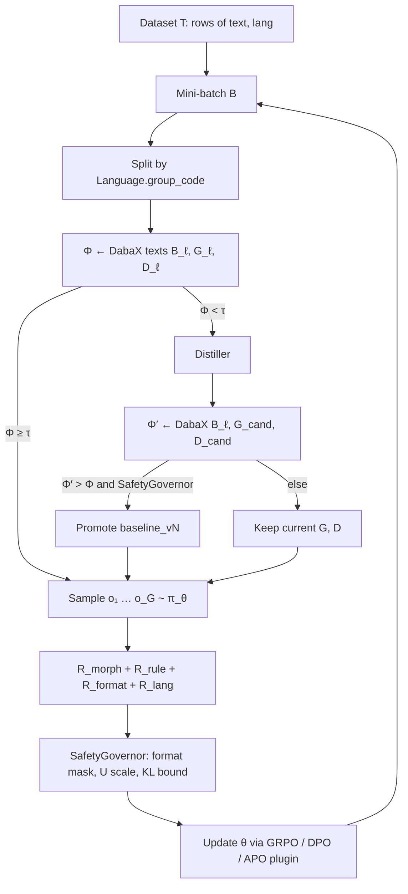

# SAMPG

**Self-Aware Morphotactic Pattern Generation** is the product loop. `sebeni train`
and `sebeni exp` **are** this loop. Completions are morphological analyses
(JSON `tokens`), not a chatbot.

## Dataset vs G, D

```
T  = [(text, lang), …]           # jsonl / csv / HF rows / packaged raw
B  ⊂ T                           # a training batch
Φ  = DabaX(texts(B_ℓ), G_ℓ, D_ℓ) # integrity of those strings
```

**G** and **D** are Daba grammar/dictionary files. They are not dataset
fields. Mixed-language batches are split by group code; the policy θ is
still **one** model.

## Loop

1. Distill G, D (HITL optional; scratch bootstrap if no packaged baseline)
2. For each batch: group by language; Φ ← DabaX
3. If Φ < τ: Distiller proposes \(G_{cand}, D_{cand}\); promote iff Φ′ > Φ
4. Serialize the active DabaX parse as ideal JSON \(y^*\)
5. Sample completions; score text integrity and annotations against \(y^*\)
6. Gate the step: zero gradients if no completion in the batch is valid JSON
   (format mask), then scale gradients by \(1/(1+\max(U,0))\)
   (U is not a reward or Distiller metric)
7. Update θ with GRPO (default) or DPO / APO plugin, on the PyTorch/TRL
   backend (default) or the optional JAX/Flax backend



`SelfAwareCallback` is the Φ / Distiller step (runs **before** the policy
update). When it promotes a checkpoint it clears that language's DabaX cache
and rebuilds the batch's \(y^*\) (`reference`) against the new G, D; the
DPO / APO plugins also rebuild their preference pairs. `distillation_hook` is
**KL scaling**, not Distiller.

YAML `algorithm: grpo | dpo | apo` changes only the policy-update plugin.
Register another with `register_algorithm(name, cls)`.

## Φ (morphological integrity)

Daba assigns a **stage** to each token:

| Stage | Meaning | Contribution to Φ |
| --- | --- | --- |
| \(0 \le x < 6\) | Fully matched / analyzed | 1.0 |
| 6 (EMPR) | Validated loanword / borrowing | `empr` (default 0.5) |
| \(> 6\) | Fallback | \(\varepsilon\) (≈ 0) |
| \(< 0\) (e.g. −1) | Unrecognized | 0.0 |
| non-numeric label | Parser label (`tokenizer`, `g.disamb`) | 1.0 |

Φ is the mean token score (recognized segments / tokens). If **Φ < τ**
(`distillation.tau`, default 0.5), Distiller runs on the batch's DabaX
misses. An LLM backend (`gguf`, `google`, `openai`, …) decides whether a miss
is a missing lemma (`\lx`) or a missing splitter / constraint (e.g. `{|na}`);
the default `algorithmic` backend only appends conservative `\lx` entries
to D and keeps G.

## Rewards

\[
R_{\mathrm{total}} = \omega_m R_{\mathrm{morph}} + \omega_r R_{\mathrm{rule}} + \omega_f R_{\mathrm{format}} + \omega_l R_{\mathrm{lang}}
\]

Default weights (`reward:`): \(\omega_m=0.4\), \(\omega_r=0.4\),
\(\omega_f=0.2\), \(\omega_l=0.2\). Custom rewards registered with
`register_reward(name, fn, weight)` are added on top.

- \(R_{morph}\): annotation quality against the DabaX ideal JSON \(y^*\):
  mean of MCS, \(1 - \mathrm{MER}\) and lemma (`form`) overlap.
- \(R_{rule}\): the completion's text re-parsed by DabaX under the active
  **G**, **D**: \(\tfrac12(\Phi + \text{lemma overlap with } y^*)\).
  Details: [Rewards](rewards.md).
- \(R_{format}\): valid **JSON** with a `tokens` list.
- \(R_{lang}\): JSON `lang` matches that row's group code (0 otherwise).

## U (uncertainty-weighted cost error)

U is a **gradient scale**, not a reward:

\[
U = \overline{\mathbb{1}[\mathrm{stage} \ne -1]} + \beta\,\overline{\log \pi_\theta - \log \pi_{\mathrm{ref}}},
\qquad g \leftarrow \frac{g}{1 + \max(U, 0)}
\]

The indicator averages the stages predicted while scoring \(R_{morph}\) /
\(R_{rule}\); the log-ratio uses the trainer's per-token log-probs and β
from `trainer.beta`. `SafetyGovernor.apply_pre_update` applies it just before
`optimizer.step` (`safety.uncertainty_downweight`). Before that, the batch is
masked: if every `R_format` score is 0 (no valid JSON) the gradients are
zeroed (`safety.format_invalid_blocks_update`), and a step whose KL exceeds
`safety.max_kl` is blocked. `u_indicator`, `u_kl` and `uncertainty` are logged
to Trackio and stored in `safety_snapshot.json`. The per-token / per-sentence
form is `MorphologyScorer.uncertainty_weighted_cost_error(_sentence)`.

## JSON completion schema

```json
{
  "text": "aw ka ne labato.",
  "lang": "bam",
  "tokens": [
    {
      "surface": "aw",
      "stage": 1,
      "analyses": [
        {
          "form": "áw",
          "ps": ["prn"],
          "gloss": "2sg",
          "morphemes": []
        }
      ]
    }
  ]
}
```

`lang` is the group code for **this sentence**. Do not mix languages inside
one JSON object.

## Policy-update plugins

| YAML `algorithm` | Class | TRL |
| --- | --- | --- |
| `grpo` | `SebeniGrpo` | `GRPOTrainer` |
| `dpo` | `SebeniDpo` | `DPOTrainer` |
| `apo` | `SebeniApo` | `DPOTrainer` + `apo_zero` / `apo_down` |

All three subclass `AlignmentPlugin` (`beni/core/srl/plugin.py`), which loads
the model (4-bit / LoRA from `model:`), wires the SafetyGovernor pre-update
hooks, writes the model card + `safety_snapshot.json`, and pushes to the Hub.
If the tokenizer has no `chat_template` (base, non-instruct LLMs such as
SmolLM2-135M), a ChatML template is set so TRL can format the
system/user prompt.

DPO/APO pairs: `chosen`/`rejected` or `completions`+`scores`.
For raw `{text, lang}` rows Sebeni builds `chosen=y*` and a legal corrupted
JSON negative; it never uses raw text as chosen or an empty rejected value.

```python
from beni.core.srl.unified import register_algorithm, SRLTrainer

register_algorithm("my_gc", MyPlugin)  # then YAML algorithm: my_gc
```

TRL notes: `GRPOTrainer` has no `ref_model` constructor argument (assign
after init); PEFT adapters are disabled on the reference; `beta` lives on
`GRPOConfig`. YAML keys TRL no longer accepts (e.g. `max_prompt_length`,
`warmup_ratio` on TRL 1.x) are dropped by `trl_config_kwargs`; with
`report_to: trackio` the run logs into the Trackio project `project_name`.

## JAX backend

```yaml
trainer:
  framework: jax          # torch (default) | jax
model:
  flax_model_name: null   # repo with Flax weights; defaults to model_name
```

`framework: jax` makes `SRLTrainer` use `JaxPolicyPlugin`
(`beni.core.srl.jax`, extra `sebeni[jax]`) instead of the registered TRL
plugin. It keeps the same DabaX rewards, \(y^*\) references, U scaling
(`jax_uncertainty_scale`), Trackio logging, model card and safety snapshot:

- `algorithm: grpo`: one row per step, \(G\) =`num_generations` samples,
  group-normalized advantages, clipped ratio (0.8–1.2) + β·KL to a frozen
  copy of the initial params, Optax AdamW.
- `algorithm: dpo` / `apo`: pairs from `rank_group_to_preference`; sigmoid
  DPO loss, or `apo_zero` / `apo_down`.

If Flax weights cannot be loaded, it warns and falls back to the PyTorch/TRL
plugin for the same `algorithm`. The initial (HITL) distill still runs, but
the JAX loop does not run `SelfAwareCallback` (no per-batch Φ / Distiller),
the format mask, or LoRA.

## Multilingual

```yaml
data:
  default_lang: bam
  languages: [bam, mku, dtm]
```

```bash
sebeni init --lang bam --lang mku --lang dtm -w ./runs/manding-001
sebeni train -c ./runs/manding-001/config.yaml
```

- One language identity per sentence.
- Φ / Distiller / G, D per group (**mku** not mlq).
- `R_lang` vs **that row**.
- Mixing languages inside one JSON object scores 0.

Example config: `configs/grpo_multilang.yaml`.
